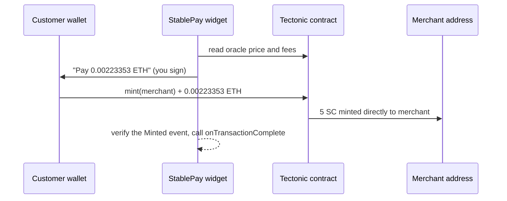

# Quick start

Let's take a real payment before we read any theory. In about five minutes you will run a tiny demo shop, open the StablePay widget, and pay yourself on the Sepolia testnet.

## You will learn

- How to run the StablePay demo shop on your machine
- How to get free testnet ETH
- What a successful payment looks like, in the widget and on-chain

## What you need

| | Why |
|---|---|
| [Node.js](https://nodejs.org) 20.19 or newer (22 recommended), and `git` | To run the demo shop |
| [MetaMask](https://metamask.io/download/) (or any browser wallet) | Your "customer" will sign with it |
| A little **Sepolia ETH** | To pay with. It is free; see step 3 |

> [!TIP]
> Never used a wallet before? Install MetaMask, create a wallet, and you will see an address that starts with `0x`. That address is all StablePay needs to know about you.

## Step 1: Get the code

```bash title="terminal"
git clone https://github.com/DjedAlliance/StablePay.git
cd StablePay/stablepay-sdk
npm install
cd example
npm install
```

The `example` folder is a one-page "Demo Shop" that sells a $5 premium subscription.

## Step 2: Tell the shop where to send the money

The demo shop needs a **receiving address**: the wallet that gets paid. Use your own MetaMask address.

Create a file called `.env.local` inside the `example` folder:

```bash title="stablepay-sdk/example/.env.local"
VITE_MERCHANT_ADDRESS=0xYourMetaMaskAddress
```

Then start the shop:

```bash title="terminal"
npm run dev
```

Open **http://localhost:5173**. You should see the Demo Shop with a **Pay with StablePay** button.

> [!NOTE]
> Paying yourself is completely fine for a test: the same wallet acts as both the customer and the merchant. If you have a second MetaMask account, use it as the merchant so you can watch the balance arrive.

## Step 3: Get some Sepolia ETH

Sepolia is Ethereum's public test network. Its ETH has no value and is given away by "faucets". Switch MetaMask to **Sepolia** (enable *Show test networks* in MetaMask's network list if you don't see it), copy your address, and request coins from a faucet such as [Google Cloud's Sepolia faucet](https://cloud.google.com/application/web3/faucet/ethereum/sepolia). Other faucets are listed on [ethereum.org](https://ethereum.org/en/developers/docs/networks/#sepolia).

`0.01` Sepolia ETH covers several test payments.

## Step 4: Pay yourself

1. Click **Pay with StablePay**.
2. Under **Select Network**, choose `sepolia`.
3. Under **Select Token**, choose **ETH (Native)**. The widget fetches a live quote and shows something like:

   ```text
   You Pay:            0.00223353 ETH
   Merchant Receives:  5 SC
   ```

4. Click **Connect Wallet** and approve the connection in MetaMask. If MetaMask is on another network, the widget asks it to switch to Sepolia.
5. Click **Pay 0.00223353 ETH** and confirm in MetaMask.

After a few seconds you will see **Transaction confirmed successfully!**, a link to the transaction on Etherscan, and a browser alert from the demo shop:

```text
Payment Successful!

Paid:     0.00223353 ETH
Received: 5 SC
```

That's it. You just paid a merchant in dollar-stable coins using only ETH, with nobody in between.

## Step 5: See your stablecoins

MetaMask doesn't show SC until you tell it about the token. In MetaMask, choose **Import tokens**, and paste the token address:

```text
0xea262fB18992ddE398a5b6fa7A4F879FfB262aC1
```

Symbol `SC`, 18 decimals. You should see your 5 SC.

> [!NOTE]
> Yes, the token address is the **Tectonic contract address**. In Tectonic the protocol contract *is* the stablecoin. There is no separate token contract. You will see this fact again and again; it simplifies a lot.

Now that you hold SC, open the widget again and pick **SC (Direct Transfer)** instead. This time the widget sends a plain token transfer, with no conversion and no protocol fee.

## What just happened?

<!-- widget:payment-flow -->



When you chose ETH, the widget asked Tectonic for the current price, worked out how much ETH buys exactly 5 SC after fees (rounding *up*, so the merchant is never short), and built a single `mint(merchant)` transaction. Tectonic minted 5 SC directly into the merchant's address. Your ETH went into Tectonic's reserve, which backs every SC in circulation.

## Next steps

- Ready to put this on a real store? Follow the [Tutorial: Add StablePay to your store](./07-integration-guide.md).
- Curious about *why* it works this way? Read [Thinking in StablePay](./03-thinking-in-stablepay.md).
