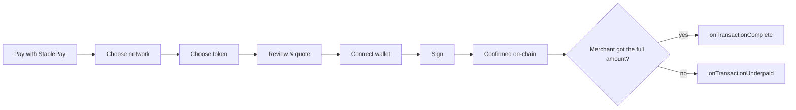

# How a payment works

From the outside, a StablePay payment is one click and one signature. Inside, the widget does a careful little dance with the wallet and the Tectonic contract. Knowing the steps makes the error messages obvious and the callbacks easy to wire up.

## You will learn

- Every step the widget takes, from the button to the receipt
- The difference between the **SC path** and the **ETH path**
- Exactly how an ETH quote is calculated, and why it is rounded up
- How the widget protects the merchant from price movements

## The journey at a glance

<!-- widget:payment-flow -->



## Step by step

### 1. The button

`<StablePay.Widget>` first renders only the **Pay with StablePay** button. Nothing touches the network yet, so the widget costs your page nothing until a customer is ready to pay.

### 2. Choosing a network

Clicking the button opens the StablePay dialog. The customer picks a network from the list you allowed. Today that list is `sepolia`. Each network is an entry in the SDK's network registry, with an RPC endpoint, a chain ID and the Tectonic contract address. See [Networks & contracts](./14-networks.md).

### 3. Choosing a token

Each network offers two tokens:

| Option in the dropdown | Key | Meaning |
|---|---|---|
| `SC (Direct Transfer)` | `stablecoin` | The customer already holds SC and sends it to you |
| `ETH (Native)` | `native` | The customer pays in ETH and Tectonic mints SC to you |

As soon as a token is picked, the widget connects to the network (no wallet needed yet) and reads Tectonic's parameters once: the fees, the decimals, the reserve-ratio thresholds, the oracle and the equity coin addresses.

### 4. Review and quote

The review screen shows what the customer pays and what you receive:

```text
Network:            sepolia
You Pay:            0.00223353 ETH
Merchant Receives:  5 SC
```

For the SC path both lines are the same number, so the widget shows only *You Pay*. For the ETH path the widget computes a **quote** (the maths is below).

The widget also checks Tectonic's reserve health and, if needed, shows a warning above the button. You will see one of these only when the protocol is under pressure:

> [!NOTE]
> *"This stablecoin currently charges a stability fee of about 0.0123% per day while its reserve ratio stays low. Balances shrink over time until reserves recover."*

> [!WARNING]
> *"This stablecoin's reserve ratio is below its critical threshold. The protocol may automatically redeem stablecoin balances for native currency, including balances received from this payment."*

These are not errors. Payments still go through; the widget simply refuses to let a merchant be surprised. [Meet Tectonic](./05-tectonic.md) explains both.

### 5. Connecting the wallet

**Connect Wallet** asks the browser wallet (MetaMask or any wallet that injects `window.ethereum`) for an account. If the wallet is on the wrong chain, the widget asks it to switch. If the wallet has never heard of the chain, the widget offers to add it. The customer stays in control the whole time: every one of these is a wallet prompt they can accept or reject.

### 6. Signing

When the customer clicks **Pay**, the widget does three things in quick succession:

1. **Re-quotes** (ETH path only). The oracle price may have moved since the dialog opened, so the widget fetches a fresh quote and uses *that* exact amount.
2. **Builds the transaction.**
   - SC path: an ERC-20 `transfer(merchant, amount)` on the Tectonic contract, which is the SC token.
   - ETH path: `mint(merchant)` on the Tectonic contract, with the quoted ETH attached. Gas is *estimated*, then padded by 50%, because a mint can do extra work when reserves are low.
3. **Double-checks the chain.** It confirms the wallet is really on the selected chain before handing over the transaction, so a payment can never be signed on the wrong network.

Then the wallet pops up and the customer signs.

### 7. Confirmation and the merchant check

The widget waits for the transaction receipt. If the transaction reverted, it shows `Transaction failed: Transaction reverted on-chain.` If it succeeded on the ETH path, the widget goes one step further and reads the `Minted` events in the receipt to confirm **how many SC actually reached the merchant**:

- At least the invoice → **Transaction confirmed successfully!** and your `onTransactionComplete` callback runs.
- Less than the invoice → the widget calls `onTransactionUnderpaid` instead, and tells the customer to contact the merchant.

> [!IMPORTANT]
> Both callbacks run in the customer's browser. Use them to *trigger* a check on your server, never as proof of payment. See [Verifying payments](./08-verify-payments.md).

## The two paths side by side

| | SC path | ETH path |
|---|---|---|
| Customer needs | SC + a little ETH for gas | ETH |
| Contract call | `transfer(merchant, amount)` | `mint(merchant)` with ETH attached |
| Protocol fee | none | `fee + devFee` on the ETH sent (0.2% on Sepolia today) |
| Price risk for merchant | none: the amount is exact | tiny: covered by re-quoting and the Minted check |
| `amount` in your callback | the SC amount | the ETH amount paid |
| `amountReceived` in your callback | the SC amount | the SC amount |

## How an ETH quote is calculated

The quote answers: *how much ETH must the customer send so that Tectonic mints at least N SC to the merchant?*

Tectonic's `mint` works like this, where `P` is the oracle price of 1 SC in wei and `D = 10^18`:

```text
net      = ethSent − ethSent × fee / D − ethSent × devFee / D
minted   = net × D / P
```

StablePay inverts that and **rounds up**:

```text
ethRequired = ceil( N × P / (D − fee − devFee) ) + 1 wei
```

Worked example with Sepolia's fees (0.1% + 0.1%) and an oracle price of 1 SC = 0.000446 ETH:

```text
5 SC × 0.000446 ETH = 0.002230 ETH   (before fees)
0.002230 / 0.998    = 0.0022345 ETH  (after fees, rounded up)
```

Try it with today's live numbers:

<!-- widget:quote-calculator -->

<details>
<summary><b>Deep dive:</b> Why add one extra wei?</summary>

Solidity integer division always rounds *down*, and the contract divides twice: once for each fee, then again by the price. Those roundings can each shave a fraction of a base unit off the minted amount. Rounding the quote up, then adding one wei (a billionth of a billionth of an ETH), guarantees the merchant receives at least the invoiced amount. The customer overpays by an amount too small to display.

The arithmetic lives in `tectonic-sdk/src/pricing.js` and mirrors the contract's operations one for one, including the two separate fee divisions, so the SDK and the contract cannot drift apart silently.

</details>

<details>
<summary><b>Deep dive:</b> Why are amounts never JavaScript numbers?</summary>

A JavaScript `number` cannot represent 18-decimal values exactly: `0.1 + 0.2` is `0.30000000000000004`. An invoice must be exact, so inside the SDK every amount is a `bigint` in base units (1 SC = `10n ** 18n`). Your `Config` takes a friendly number like `12`, and the SDK converts it once, as a decimal string, with no floating-point maths. If you price with many decimals, write them carefully; the SDK refuses values it cannot represent exactly rather than silently charging a slightly different amount.

</details>

## Recap

- The widget reads Tectonic's parameters once, then quotes, warns, connects, re-quotes and signs.
- SC path: a plain token transfer, exact and fee-free.
- ETH path: `mint(merchant)` with ETH attached; Tectonic mints SC straight to you.
- Quotes are rounded up and refreshed right before signing, and the receipt is checked for the minted amount.
- Callbacks are browser-side hints. Your server confirms.
