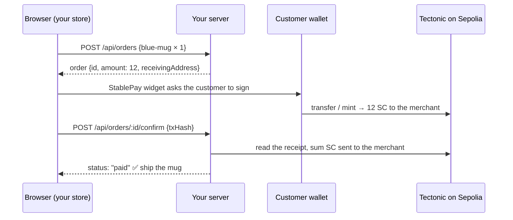

# Tutorial: Add StablePay to your store

In this tutorial you will add a StablePay checkout to an online store, step by step, and finish with a store that **creates orders on the server, takes payment in the browser, and confirms every payment against the blockchain** before shipping anything. Every file is shown in full. You can copy each block as it is.

## You will learn

- How to install StablePay and its Tectonic SDK
- How to render the checkout with an amount your server decided
- How to confirm a payment on your server in about forty lines
- How to handle slow confirmations, underpayments and failures
- What to check before you take real money

<!-- widget:tutorial-map -->

## What we're building

We'll build the checkout for **Northwind Mugs**, a tiny React store with a Node.js API. When we're done, buying a mug works like this:



If you already have a store, follow along and drop each piece into your own code. The [Next.js](./09-nextjs.md) and [any website](./10-any-website.md) guides show the same widget in other setups; the server part is identical everywhere.

> [!TIP]
> Short on time? Steps 1 to 6 give you a working checkout in about ten minutes. Steps 7 to 10 make it **safe to ship orders**. Don't skip them for a real store.

---

### Step 1: Check your tools

You need:

1. **Node.js 20.19 or newer** (22 recommended). Run `node -v` in a terminal. If it prints `v22…`, or `v20.19` or higher, you're set.
2. **A browser wallet**, such as [MetaMask](https://metamask.io/download/), switched to the **Sepolia** test network.
3. **A receiving address.** This is the wallet that gets paid. Copy it from MetaMask; it looks like `0x5aF3…c9E1`. Ideally make a separate account for your store.
4. **A little Sepolia ETH** in the wallet you'll pay *from*, from a faucet such as [Google Cloud's Sepolia faucet](https://cloud.google.com/application/web3/faucet/ethereum/sepolia).

> [!WARNING]
> Everything in this tutorial runs on the **Sepolia testnet**, where coins are free and worthless. That's the point: you can make mistakes for free. Tectonic is not yet on a mainnet.

### Step 2: Create the store (or open yours)

If you're following from scratch, create a React app with Vite:

```bash title="terminal"
npm create vite@latest northwind -- --template react
cd northwind
npm install
```

Your folder now looks like this. We'll add the highlighted files along the way:

```text
northwind/
├── .env                      ← step 7
├── package.json
├── vite.config.js            ← step 7
├── server/
│   ├── index.js              ← step 7
│   └── verifyPayment.js      ← step 8
└── src/
    ├── App.jsx               ← step 5
    ├── StablePayCheckout.jsx ← step 4, finished in step 9
    └── main.jsx
```

### Step 3: Install StablePay

StablePay comes in two packages that live side by side in the StablePay repository:

- **`stablepay-sdk`**: the checkout widget you render.
- **`tectonic-sdk`**: the library the widget uses to talk to Tectonic. You'll use it directly only for advanced tasks.

> [!IMPORTANT]
> **Install from source for now.** The `stablepay-sdk` package on npm is an older release that predates Tectonic. Until the Tectonic release is published to npm, install both packages from the StablePay repository as shown below. When it is published, the whole of this step becomes `npm install stablepay-sdk`.

**3a.** Download the StablePay repository **next to** your store's folder (not inside it):

```bash title="terminal"
cd ..
git clone https://github.com/DjedAlliance/StablePay.git
cd northwind
```

You now have:

```text
your-projects/
├── StablePay/     ← the SDKs
└── northwind/     ← your store
```

**3b.** Open `northwind/package.json` and add this `overrides` block at the top level (next to `"dependencies"`):

```json title="package.json"
{
  "overrides": {
    "stablepay-sdk": {
      "react": "$react",
      "react-dom": "$react-dom"
    }
  }
}
```

This tells npm "StablePay must use **my** copy of React". Without it, a React 19 app ends up with two copies of React and the widget crashes with `Cannot read properties of null (reading 'useState')`.

**3c.** Install both packages, plus `express` and `viem` for the server we'll write in step 7:

```bash title="terminal"
npm install --install-links ../StablePay/tectonic-sdk ../StablePay/stablepay-sdk
npm install express viem
```

The `--install-links` flag makes npm *copy* the packages into `node_modules` instead of linking to the other folder, which is what your bundler expects.

<details>
<summary><b>Deep dive:</b> What did that just install?</summary>

- `stablepay-sdk` ships prebuilt bundles in `dist/` (ES modules and UMD) plus one stylesheet. Inside, it has already bundled the Tectonic SDK, so at runtime it only needs `react`, `react-dom` and `viem` from your project.
- `tectonic-sdk` is listed because `stablepay-sdk` declares it as a local dependency. Having it in your project also lets your server code import it later, for balances and redemptions.
- `viem` is the Ethereum library both the widget and your server use to read the chain.

</details>

### Step 4: Create the checkout component

Create `src/StablePayCheckout.jsx`. This first version just renders the widget for an order:

```jsx title="src/StablePayCheckout.jsx"
import { useMemo } from 'react'
import StablePay from 'stablepay-sdk'
import 'stablepay-sdk/dist/esm/styles.css'

export default function StablePayCheckout({ order }) {
  const networkSelector = useMemo(() => {
    const config = new StablePay.Config({
      receivingAddress: order.receivingAddress,
      amounts: { [order.network]: { stablecoin: order.amount } },
    })
    return new StablePay.NetworkSelector(config)
  }, [order.id, order.receivingAddress, order.network, order.amount])

  return (
    <StablePay.Widget
      networkSelector={networkSelector}
      onTransactionComplete={(payment) => console.log('Payment sent', payment)}
    />
  )
}
```

Line by line:

- **`import 'stablepay-sdk/dist/esm/styles.css'`** loads the widget's styles. Forget it and the dialog renders as unstyled HTML.
- **`StablePay.Config`** is where you say *who gets paid* (`receivingAddress`) and *how much* (`amounts`), per network. `order.network` will be `'sepolia'`.
- **`StablePay.NetworkSelector`** turns the config into the list of networks the customer can pick from.
- **`useMemo`** builds the selector once per order. The widget remembers the customer's choices inside it, so you must not create a new one on every render.
- **`StablePay.Widget`** renders the **Pay with StablePay** button and, when clicked, the whole payment dialog.

> [!WARNING]
> `stablecoin` must be a **number greater than zero**, like `12` or `12.5`. A string such as `'12'` throws `Invalid stablecoin amount for network sepolia`. If your prices come from an API as strings, wrap them with `Number(…)`.

### Step 5: Put it on the page

Replace `src/App.jsx` with a minimal product page. For now we hard-code the order so you can see the widget immediately; in step 7 the server creates it.

```jsx title="src/App.jsx"
import StablePayCheckout from './StablePayCheckout'

const order = {
  id: 'demo-1',
  amount: 12,
  network: 'sepolia',
  receivingAddress: '0xYourReceivingAddress',
}

export default function App() {
  return (
    <main>
      <h1>Northwind Mugs</h1>
      <h2>Blue Mug: 12 SC</h2>
      <StablePayCheckout order={order} />
    </main>
  )
}
```

Replace `0xYourReceivingAddress` with your address, then start the app:

```bash title="terminal"
npm run dev
```

Open the address Vite prints (usually **http://localhost:5173**). You should see the product and a **Pay with StablePay** button.

### Step 6: Take your first payment

Click **Pay with StablePay**, choose **sepolia**, choose **ETH (Native)**, and you'll see a live quote:

```text
You Pay:            0.00536048 ETH
Merchant Receives:  12 SC
```

Click **Connect Wallet**, then **Pay**, and confirm in MetaMask. When it's done, open your browser's developer console. You'll find the object passed to `onTransactionComplete`:

```js
{
  txHash: '0x86d6…0587',
  network: 'sepolia',
  token: 'native',
  amount: '0.00536048',     // what the customer paid…
  tokenSymbol: 'ETH',       // …in this currency
  amountReceived: 12,       // what you received…
  receivedSymbol: 'SC',     // …always in SC
  receivingAddress: '0xYourReceivingAddress',
}
```

🎉 **You have a working checkout.** If something went wrong, the [Troubleshooting](./15-troubleshooting.md) page lists every error message the widget can show.

> [!CAUTION]
> Stop here only for a demo. Right now *anyone* can open the console and pretend a payment happened. The next four steps make the server the judge of what is paid.

### Step 7: Let the server create orders

The browser must never decide the price. Your server knows the catalogue, so the server creates the order and tells the browser how much to charge.

**7a.** Create a `.env` file in the project root with your receiving address:

```bash title=".env"
MERCHANT_ADDRESS=0xYourReceivingAddress
```

**7b.** Create `server/index.js`:

```js title="server/index.js"
import express from 'express'
import { randomUUID } from 'node:crypto'
import { formatUnits, isAddress } from 'viem'
import { verifyPayment } from './verifyPayment.js'

const MERCHANT_ADDRESS = process.env.MERCHANT_ADDRESS
if (!isAddress(MERCHANT_ADDRESS ?? '')) {
  throw new Error('Set MERCHANT_ADDRESS in .env to the wallet address that receives payments')
}

const catalog = {
  'blue-mug': { name: 'Blue Mug', price: 12 },
  'tea-towel': { name: 'Tea Towel', price: 5 },
}

const orders = new Map()
const txHashOwners = new Map()

const app = express()
app.use(express.json())

app.post('/api/orders', (req, res) => {
  const items = Array.isArray(req.body.items) ? req.body.items : []
  let amount = 0
  for (const { sku, quantity } of items) {
    const product = catalog[sku]
    if (!product || !Number.isInteger(quantity) || quantity < 1) {
      return res.status(400).json({ error: `Invalid item: ${sku}` })
    }
    amount += product.price * quantity
  }
  if (amount <= 0) return res.status(400).json({ error: 'Your cart is empty' })

  const order = {
    id: randomUUID(),
    items,
    amount,
    network: 'sepolia',
    receivingAddress: MERCHANT_ADDRESS,
    status: 'awaiting_payment',
  }
  orders.set(order.id, order)
  res.status(201).json(order)
})

app.get('/api/orders/:id', (req, res) => {
  const order = orders.get(req.params.id)
  if (!order) return res.status(404).json({ error: 'Order not found' })
  res.json(order)
})

app.post('/api/orders/:id/confirm', async (req, res) => {
  const order = orders.get(req.params.id)
  if (!order) return res.status(404).json({ error: 'Order not found' })
  if (order.status === 'paid') return res.json(order)

  const txHash = String(req.body.txHash ?? '').toLowerCase()
  if (!/^0x[0-9a-f]{64}$/.test(txHash)) {
    return res.status(400).json({ error: 'txHash must be a 0x-prefixed 32-byte hash' })
  }

  const owner = txHashOwners.get(txHash)
  if (owner && owner !== order.id) {
    return res.status(409).json({ error: 'This transaction already paid for another order' })
  }
  txHashOwners.set(txHash, order.id)

  const result = await verifyPayment({
    txHash,
    merchantAddress: MERCHANT_ADDRESS,
    expectedAmount: order.amount,
  })

  if (result.status === 'failed') {
    txHashOwners.delete(txHash)
    return res.status(422).json({ ...order, verification: result })
  }

  if (result.status === 'pending') {
    return res.status(202).json({ ...order, verification: result })
  }

  order.txHash = txHash
  order.payer = result.payer
  order.received = formatUnits(result.received, 18)
  order.status = result.status === 'paid' ? 'paid' : 'underpaid'
  res.json(order)
})

const port = process.env.PORT ?? 3001
app.listen(port, () => console.log(`Northwind API listening on http://localhost:${port}`))
```

Three routes:

| Route | Job |
|---|---|
| `POST /api/orders` | Prices the cart **from the server's catalogue** and stores a new order |
| `GET /api/orders/:id` | Lets the browser read an order's status |
| `POST /api/orders/:id/confirm` | Takes a transaction hash and asks the blockchain whether it paid this order |

The `txHashOwners` map makes sure **one payment can settle one order**: the moment a hash is claimed by an order, no other order can use it.

> [!NOTE]
> The `Map`s keep this tutorial short, but they forget everything when the server restarts. In your store, use your real database, and put a **unique constraint** on the transaction-hash column. That one constraint is your protection against a payment being reused.

**7c.** Tell Vite to forward `/api` requests to this server. Replace `vite.config.js`:

```js title="vite.config.js"
import react from '@vitejs/plugin-react'
import { defineConfig } from 'vite'

export default defineConfig({
  plugins: [react()],
  server: {
    proxy: {
      '/api': 'http://localhost:3001',
    },
  },
})
```

**7d.** Add a script to start the server. In `package.json`, inside `"scripts"`, add:

```json title="package.json"
"server": "node --env-file=.env server/index.js"
```

The server won't start yet: it imports `verifyPayment.js`, which we write next.

### Step 8: Verify payments against the chain

This is the heart of a safe integration. Create `server/verifyPayment.js`:

```js title="server/verifyPayment.js"
import {
  createPublicClient,
  http,
  parseAbi,
  parseEventLogs,
  parseUnits,
  isAddressEqual,
} from 'viem'
import { sepolia } from 'viem/chains'

const TECTONIC_SC = '0xea262fB18992ddE398a5b6fa7A4F879FfB262aC1'
const MIN_CONFIRMATIONS = 2n

const client = createPublicClient({
  chain: sepolia,
  transport: http(process.env.RPC_URL ?? 'https://ethereum-sepolia-rpc.publicnode.com'),
})

const transferEvent = parseAbi([
  'event Transfer(address indexed from, address indexed to, uint256 value)',
])

export async function verifyPayment({ txHash, merchantAddress, expectedAmount }) {
  let receipt
  try {
    receipt = await client.getTransactionReceipt({ hash: txHash })
  } catch {
    return { status: 'pending', reason: 'Transaction not found or not mined yet' }
  }

  if (receipt.status !== 'success') {
    return { status: 'failed', reason: 'Transaction reverted' }
  }

  const latest = await client.getBlockNumber()
  const confirmations = latest - receipt.blockNumber + 1n
  if (confirmations < MIN_CONFIRMATIONS) {
    return { status: 'pending', reason: `${confirmations} of ${MIN_CONFIRMATIONS} confirmations` }
  }

  const received = parseEventLogs({ abi: transferEvent, logs: receipt.logs, eventName: 'Transfer' })
    .filter((log) => isAddressEqual(log.address, TECTONIC_SC))
    .filter((log) => isAddressEqual(log.args.to, merchantAddress))
    .reduce((sum, log) => sum + log.args.value, 0n)

  const expected = parseUnits(String(expectedAmount), 18)

  if (received < expected) {
    return { status: 'underpaid', received, expected, payer: receipt.from }
  }

  return { status: 'paid', received, expected, payer: receipt.from, blockNumber: receipt.blockNumber }
}
```

What it checks, in order:

1. **The transaction exists and succeeded.** A reverted transaction moved no money.
2. **It is buried under at least two blocks.** Very recent blocks can occasionally be replaced; waiting one extra block makes that vanishingly unlikely on Sepolia. Raise this for high-value orders.
3. **SC actually reached *your* address, from the real Tectonic contract.** It adds up every SC `Transfer` event in the receipt whose recipient is you. This one rule covers both payment paths: a direct SC payment emits `Transfer(customer → you)`, and an ETH payment emits `Transfer(0x0 → you)` when Tectonic mints.
4. **The amount covers the order.** Compared as exact integers, never floats.

> [!IMPORTANT]
> Checking `log.address` is what stops a scammer from deploying their own token called "SC" and "paying" you with it. Only Transfer events emitted **by the Tectonic contract** count.

Now start the server in a **second terminal** and leave it running:

```bash title="terminal 2"
npm run server
```

You should see `Northwind API listening on http://localhost:3001`.

### Step 9: Connect the widget to your server

Now replace `src/StablePayCheckout.jsx` with its finished version. It sends the transaction hash to the server, waits patiently for confirmations, and handles every outcome:

```jsx title="src/StablePayCheckout.jsx"
import { useMemo, useState } from 'react'
import StablePay from 'stablepay-sdk'
import 'stablepay-sdk/dist/esm/styles.css'

const sleep = (ms) => new Promise((resolve) => setTimeout(resolve, ms))

async function confirmOnServer(orderId, txHash) {
  for (let attempt = 0; attempt < 20; attempt++) {
    const response = await fetch(`/api/orders/${orderId}/confirm`, {
      method: 'POST',
      headers: { 'Content-Type': 'application/json' },
      body: JSON.stringify({ txHash }),
    })
    const order = await response.json()
    if (response.status !== 202) return { ok: response.ok, order }
    await sleep(4000)
  }
  return { ok: false, order: { error: 'Still waiting for confirmations. Refresh in a minute.' } }
}

export default function StablePayCheckout({ order, onPaid }) {
  const [status, setStatus] = useState('idle')
  const [message, setMessage] = useState('')

  const networkSelector = useMemo(() => {
    const config = new StablePay.Config({
      receivingAddress: order.receivingAddress,
      amounts: { [order.network]: { stablecoin: order.amount } },
    })
    return new StablePay.NetworkSelector(config)
  }, [order.id, order.receivingAddress, order.network, order.amount])

  const handleComplete = async (payment) => {
    setStatus('verifying')
    setMessage('Payment sent. Confirming it on the blockchain…')
    const { ok, order: updated } = await confirmOnServer(order.id, payment.txHash)
    if (ok && updated.status === 'paid') {
      setStatus('paid')
      onPaid(updated)
    } else if (updated.status === 'underpaid') {
      setStatus('underpaid')
      setMessage(`We received ${updated.received} SC of ${updated.amount} SC. We'll be in touch about the difference.`)
    } else {
      setStatus('error')
      setMessage(updated.error ?? 'We could not confirm this payment. Please contact us.')
    }
  }

  const handleUnderpaid = async (payment) => {
    setStatus('underpaid')
    setMessage(`Your payment arrived short by ${payment.shortfall} SC. Our team will contact you.`)
    await confirmOnServer(order.id, payment.txHash)
  }

  return (
    <div className="stablepay-checkout">
      <StablePay.Widget
        networkSelector={networkSelector}
        onTransactionComplete={handleComplete}
        onTransactionUnderpaid={handleUnderpaid}
      />
      {status !== 'idle' && <p className={`checkout-status ${status}`}>{message}</p>}
    </div>
  )
}
```

The server answers `202 Accepted` while the transaction is still collecting confirmations, so `confirmOnServer` simply asks again every four seconds. Notice that even the **underpaid** path tells the server: the server is the record of truth, so it should know about every payment, short or not.

And replace `src/App.jsx` so the **server** creates the order:

```jsx title="src/App.jsx"
import { useState } from 'react'
import StablePayCheckout from './StablePayCheckout'

export default function App() {
  const [order, setOrder] = useState(null)
  const [paidOrder, setPaidOrder] = useState(null)
  const [error, setError] = useState('')

  const startCheckout = async () => {
    setError('')
    const response = await fetch('/api/orders', {
      method: 'POST',
      headers: { 'Content-Type': 'application/json' },
      body: JSON.stringify({ items: [{ sku: 'blue-mug', quantity: 1 }] }),
    })
    const body = await response.json()
    if (!response.ok) return setError(body.error)
    setOrder(body)
  }

  if (paidOrder) {
    return (
      <main>
        <h1>Thank you!</h1>
        <p>Order {paidOrder.id} is paid. Your mug is on its way.</p>
        <a href={`https://sepolia.etherscan.io/tx/${paidOrder.txHash}`} target="_blank" rel="noreferrer">
          View the payment on Etherscan
        </a>
      </main>
    )
  }

  return (
    <main>
      <h1>Northwind Mugs</h1>
      <h2>Blue Mug: 12 SC</h2>
      {!order && <button onClick={startCheckout}>Checkout</button>}
      {error && <p role="alert">{error}</p>}
      {order && (
        <section>
          <p>Order total: <strong>{order.amount} SC</strong></p>
          <StablePayCheckout order={order} onPaid={setPaidOrder} />
        </section>
      )}
    </main>
  )
}
```

The receiving address now comes from the server's `.env`, through the order. There is one place to change it, and the browser can't tamper with it in a way that matters: if someone edits it in their browser, they simply pay someone else, and your server never sees SC arrive.

### Step 10: Test the whole flow

With `npm run dev` in one terminal and `npm run server` in the other, open the store and walk through these. Tick them off as you go:

1. **Pay with ETH.** Checkout → Pay with StablePay → sepolia → ETH (Native) → Connect → Pay. After a few seconds you should land on **Thank you!**
2. **Pay with SC.** You now hold SC from step 6 (if you paid yourself). Start a new checkout and choose **SC (Direct Transfer)**.
3. **Reject in the wallet.** Click Pay, then *Reject* in MetaMask. The widget shows `Transaction failed: User denied transaction` and nothing reaches your server.
4. **Wrong network.** Switch MetaMask to another network before clicking Pay. The widget asks to switch back.
5. **Try to cheat.** Create an order, then send a fake hash yourself:

   ```bash title="terminal 3"
   curl -X POST http://localhost:3001/api/orders \
     -H 'Content-Type: application/json' \
     -d '{"items":[{"sku":"blue-mug","quantity":1}]}'
   # copy the "id" from the response, then:
   curl -X POST http://localhost:3001/api/orders/PASTE_ID_HERE/confirm \
     -H 'Content-Type: application/json' \
     -d '{"txHash":"0x1111111111111111111111111111111111111111111111111111111111111111"}'
   ```

   The server answers `202` with `"Transaction not found or not mined yet"`, and the order stays unpaid. Now try the **real** hash from test 1 against this new order: the server answers `409 This transaction already paid for another order`.

If all five behave as described, your store is doing everything right.

## Going live checklist

Before you point real customers at your checkout:

- [ ] Orders are stored in a real database, with a **unique** constraint on the transaction hash.
- [ ] Prices are computed **on the server** from your catalogue.
- [ ] Orders are fulfilled **only** when your server marks them `paid`.
- [ ] Your server uses an RPC endpoint you trust (set `RPC_URL`). Public endpoints are fine for testing; for production, use a provider with an SLA, or your own node.
- [ ] You picked `MIN_CONFIRMATIONS` to suit your order values.
- [ ] Your receiving address is a dedicated wallet whose keys are safely backed up (hardware wallet or multisig recommended).
- [ ] You have a written refund and underpayment policy (see [Getting paid](./06-getting-paid.md)).
- [ ] You know where to watch for stability fees and triggered redemptions on your SC (see [Meet Tectonic](./05-tectonic.md)).
- [ ] You switch from Sepolia to a mainnet network **only** once Tectonic lists one on the [networks page](./14-networks.md).

## Recap

You built a checkout where:

- the **server** decides the price and owns the order,
- the **widget** collects the payment directly from the customer's wallet to yours,
- the **server** confirms every payment on-chain, by summing SC Transfer events to your address from the Tectonic contract,
- one transaction can settle only one order, and slow confirmations, underpayments and failures are all handled.

Next, read [Verifying payments](./08-verify-payments.md) for production-grade variations, such as watching your address instead of polling, and handling underpayments in depth.
